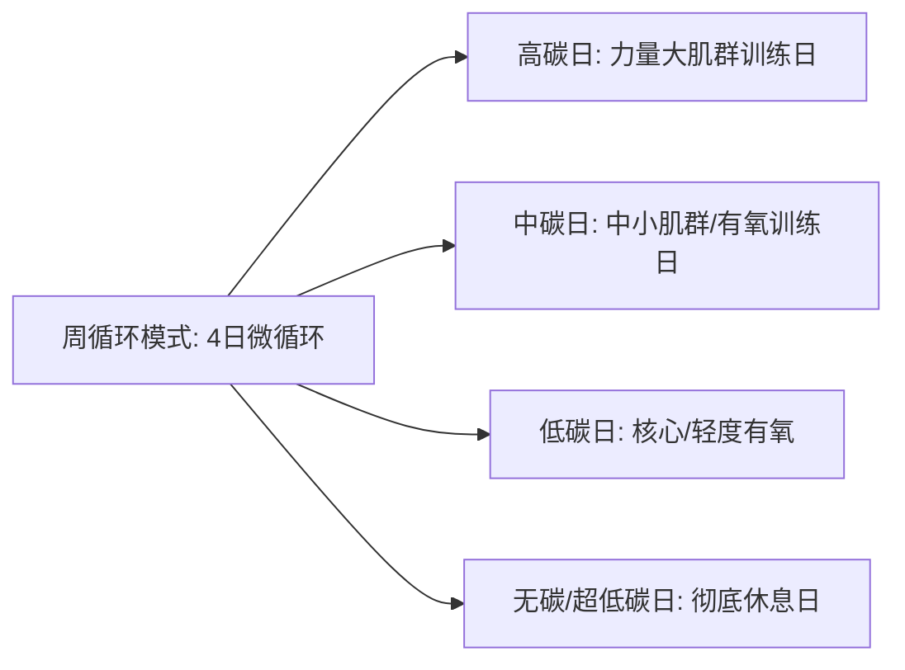

# 科学减脂餐与轻食备餐全百科 (28天碳水循环·高蛋白防掉肌·好吃不吃草)

---

## 第一章 能量代谢生理学与精准营养构架

科学减脂的底层不是挨饿，而是**在维持身体基础代谢（BMR）和保护瘦体重（Lean Mass）的前提下，通过热量缺口迫使脂肪供能**。

### 1.1 精准热量缺口测算 (Mifflin-St Jeor 公式)
$$\text{BMR (男)} = 10 \times \text{体重(kg)} + 6.25 \times \text{身高(cm)} - 5 \times \text{年龄} + 5$$
$$\text{BMR (女)} = 10 \times \text{体重(kg)} + 6.25 \times \text{身高(cm)} - 5 \times \text{年龄} - 161$$
$$\text{TDEE (每日总消耗)} = \text{BMR} \times \text{活动系数 (久坐1.2 / 轻度运动1.375 / 中度1.55 / 高强1.725)}$$
- **黄金减脂热量**：$\text{TDEE} - 350 \sim 500 \text{ kcal}$（绝不可低于 BMR，否则机体启动饥荒应激，甲状腺素分泌骤降，代谢断崖式下跌）。

### 1.2 三大营养素黄金克重配比
1. **蛋白质 (Protein)**：**1.6g ~ 2.2g / kg 体重**。蛋白质食物热效应（TEF）高达 20%~30%，不仅防止减脂期肌肉分解，更能平稳下丘脑饥饿素（Ghrelin）。
2. **碳水化合物 (Carbohydrate)**：**1.5g ~ 3.0g / kg 体重**。采用低 GI/低 GL 慢碳，严控游离精制糖，保证甲状腺功能与训练运动表现。
3. **健康脂肪 (Fat)**：**0.6g ~ 0.9g / kg 体重**（供能比约 20%~25%）。以特级初榨橄榄油（单不饱和脂肪酸）、深海鱼油（Omega-3 EPA/DHA）、坚果、牛油果为主，维持性激素（睾酮、雌激素）正常分泌。

---

## 第二章 突破减脂瓶颈：碳水循环法 (Carb Cycling) 全套体系

长期单一低热量饮食必遭代谢代偿适应。**碳水循环法**通过高碳日补充肝糖原和肌糖原、刺激瘦素（Leptin）分泌拉升代谢，低碳/无碳日高效燃脂：

### 2.1 四类循环日全天参数与宏量配比 (以 65kg 成人为例)
- **高碳日 (High Carb Day)**：
  - 碳水 3.5g/kg (227g) | 蛋白质 1.8g/kg (117g) | 脂肪 0.4g/kg (26g) | 总热量约 1610 kcal
  - 核心目的：重训日（深蹲/硬拉/卧推），高胰岛素窗口充盈肌糖原，防止代谢变慢。
- **中碳日 (Moderate Carb Day)**：
  - 碳水 2.0g/kg (130g) | 蛋白质 2.0g/kg (130g) | 脂肪 0.6g/kg (39g) | 总热量约 1390 kcal
- **低碳日 (Low Carb Day)**：
  - 碳水 0.8g/kg (52g) | 蛋白质 2.2g/kg (143g) | 脂肪 0.8g/kg (52g) | 总热量约 1250 kcal
  - 核心目的：胰岛素平稳低位，加速游离脂肪酸氧化。
- **无碳/超低碳日 (Zero/Minimal Carb Day)**：
  - 仅摄入蔬菜微量碳水 (<25g) | 蛋白质 2.2g/kg (143g) | 脂肪 1.0g/kg (65g) | 总热量约 1250 kcal

---

## 第三章 肉类分子级嫩化与锁水黑科技 (告别干柴水煮)

减脂餐难以下咽的罪魁祸首是**肌纤维脱水变性与缺乏风味分子**：

### 3.1 鸡胸肉 3% 盐糖渗透水合浸润法 (Brining)
- **生化原理**：盐离子渗入肌纤维内部改变蛋白质电荷，破开肌动蛋白与肌球蛋白交联，使肌肉细胞网络吸附并锁住额外 18% 的水分；极微量糖可发生轻微褐变反应增香。
- **操作 SOP**：
  1. 纯净水 1000ml + 食品级食盐 30g (3%) + 0卡代糖 15g (1.5%) 搅拌溶解。
  2. 加入 2 片新鲜柠檬片、拍碎葱姜与数粒白胡椒粒。
  3. 鸡胸肉顺肌理斜划浅刀花（深约肉厚 1/3），全浸没于水溶液中，盖盖冷藏腌泡 **3 ~ 5 小时**（切勿超过 8 小时防过咸）。
  4. 捞出后用厨房纸吸净表面水液，小火加盖焖煎 3 分钟翻面 2 分钟，肉嫩多汁如生蚝！

### 3.2 瘦牛肉与猪里脊弱碱膨胀法 (小苏打变性)
- **生化原理**：牛肉结缔组织紧密，小苏打（碳酸氢钠）微弱提高肉体表面 pH 值（呈弱碱性），让肉蛋白分子远离等电点产生静电斥力，肌纤维网格舒展吸水，入口完全无筋感。
- **操作 SOP**：
  - 250g 牛柳逆纹横切 2mm 薄片。
  - 加入小苏打 1.5g、葱姜水 25ml、无糖料酒 10ml，单方向连续抓打至水分被牛肉完全吃透吸收（起黏性）。
  - 打入半颗蛋清抓匀，封入 5g 玉米淀粉和 5ml 特级初榨橄榄油（封油锁水）。冷藏静置 20 分钟后滑炒，滑嫩胜似豆腐。

---

## 第四章 20 款“0糖/低脂/无负担”万能神仙减脂酱汁矩阵

自制酱汁是轻食的灵魂，可将市售沙拉酱（热量高达 500~700 kcal/100g）骤降至 30~80 kcal：

| 酱汁名称 | 核心配料配比 (单份按 35g 计) | 单份卡路里 | 适配食材与应用场景 |
| :--- | :--- | :--- | :--- |
| **经典意式香草油醋汁** | 橄榄油 5ml + 红酒醋/苹果醋 18ml + 第戎芥末酱 5g + 现磨黑椒海盐 + 0卡糖 3g | 48 kcal | 羽衣甘蓝、生菜、小番茄、水煮大虾 |
| **泰式青柠海鲜酸辣汁** | 鲜青柠汁 15ml + 特级鱼露 8ml + 生抽 8ml + 鲜小米辣圈 3g + 捣碎蒜泥 5g + 香菜碎 + 0卡糖 5g | 21 kcal | 鲜虾魔芋丝、去皮手撕鸡丝、蒸鱿鱼圈 |
| **减脂期无油日式照烧汁** | 减盐生抽 15ml + 无糖料理清酒 10ml + 纯净水 20ml + 0卡糖 8g + 鲜姜末 2g + 淀粉水 3ml | 19 kcal | 香煎三文鱼排、照烧嫩鸡胸、煎老豆腐 |
| **低卡仿香浓花生麻酱** | 无糖脱脂纯牛奶 20ml + 纯无添加花生酱 8g + 减盐生抽 5ml + 陈醋 4ml + 0卡糖 3g + 熟白芝麻 | 62 kcal | 荞麦冷面、大拌菜、减脂暖沙拉、菠菜拌木耳 |
| **法式清爽无油酸奶蒜香酱** | 0蔗糖无糖希腊酸奶 25g + 柠檬汁 5ml + 蒜泥 3g + 莳萝草/法香碎 1g + 海盐黑胡椒 | 28 kcal | 烤蔬菜拼盘、烤龙利鱼排、全麦卷饼抹酱 |
| **日式风味青芥末和风汁** | 生抽 12ml + 苹果醋 10ml + 青芥末辣根 2g + 柴鱼高汤 15ml + 0卡糖 4g + 焙煎白芝麻 | 24 kcal | 豆腐海藻沙拉、刺身级金枪鱼、水煮秋葵 |
| **墨西哥风味牛油果莎莎酱** | 熟透牛油果肉 20g 碾泥 + 鲜番茄丁 20g + 洋葱碎 10g + 柠檬汁 8ml + 鲜香菜碎 + 辣椒仔 Tabasco 3滴 | 42 kcal | 全麦墨西哥牛肉卷、香煎鸡肉、粗粮玉米片 |
| **韩式低卡甜辣拌酱** | 低钠韩式辣酱 8g + 苹果泥 10g + 0卡糖 5g + 蒜泥 4ml + 熟白芝麻 + 苹果醋 5ml | 36 kcal | 韩式牛肉魔芋拌饭、生菜包烤肉 |
| **粤式生姜红葱低卡油泼料** | 小葱白末 15g + 鲜老姜泥 15g + 纯花生油 5ml（烧滚泼香）+ 盐 2g + 高汤 10ml | 49 kcal | 减脂白切鸡胸、白灼时蔬、清蒸罗非鱼 |
| **秘制低卡麻辣钵钵鸡冷泡汁** | 鸡高汤 100ml + 减盐生抽 20ml + 鲜花椒油 3ml + 辣椒粉 5g + 熟白芝麻 3g + 蒜末姜片藤椒 | 55 kcal | 蔬菜鸡肉冷锅串串、减脂打牙祭高蛋白冷泡 |

---

## 第五章 15 款大厨级高蛋白饱腹减脂明星食谱详析

### 食谱 1：【经典销冠】柠檬黑椒爆汁香煎鸡胸肉便当
- **热量与宏量**：**385 kcal** | 蛋白质 42g | 碳水 36g | 脂肪 7g
- **食材清单**：
  - 鸡胸肉 180g（经 3% 盐糖浸润法预处理）
  - 优质碳水：蒸贝贝南瓜 150g（切瓣带皮蒸透）
  - 纤维蔬菜：水焯西兰花 100g + 圣女果 5 颗
  - 调味：现磨黑胡椒粗粒 3g、新鲜柠檬汁 10ml、蒜瓣 2 瓣拍碎
- **出品 SOP**：
  1. 平底不粘锅喷雾橄榄油 2 次（约 1g），大火把锅烧至滚烫。
  2. 鸡胸肉下锅，强火两面各煎 90 秒锁住金黄焦褐外壳。
  3. 转中小火，盖上锅盖利用锅内聚积的水汽**焖煎 2.5 分钟**。
  4. 揭盖淋入柠檬汁，撒入现磨黑胡椒与蒜碎，离火**静置 3 分钟切块**。南瓜与西兰花码入便当盒，淋少许黑胡椒即成。

### 食谱 2：【低碳爆汁】免油炸孜然香烤高蛋白龙利鱼柳
- **热量与宏量**：**310 kcal** | 蛋白质 38g | 碳水 12g | 脂肪 11g
- **食材清单**：
  - 龙利鱼柳 / 巴沙鱼柳 250g（自然解冻彻底吸干水分）
  - 腌料：生抽 10ml、料酒 10ml、白胡椒粉 2g、生姜丝 10g
  - 撒粉：纯孜然粒 5g、熟辣椒面 3g、白芝麻 3g、海盐 2g
- **出品 SOP**：
  1. 鱼柳切成 2.5cm 宽的大块厚柳，加入生抽、料酒、生姜丝抓匀冷藏腌渍 15 分钟。
  2. 烤盘铺硅油纸，鱼柳表面刷极薄一层橄榄油（约 2g），均匀双面撒满孜然粉、辣椒面与白芝麻。
  3. 烤箱预热至 **200℃，上下火热风烘烤 15~18 分钟**（或空气炸锅 190℃ 烤 12 分钟）。鱼肉外层香脆焦润，内部白嫩多汁，香辣鲜甜！

### 食谱 3：【低碳抱蛋】滑蛋牛肉彩椒全麦卷饼
- **热量与宏量**：**430 kcal** | 蛋白质 36g | 碳水 44g | 脂肪 12g
- **食材清单**：
  - 牛柳薄片 100g（采用小苏打弱碱变性法抓嫩）
  - 全麦卷饼皮 1 张（约 60g）
  - 鲜鸡蛋 2 颗（打散加 15ml 牛奶提高滑嫩度）
  - 黄色彩椒丝 40g、紫洋葱丝 30g、黑胡椒海盐少许
- **出品 SOP**：
  1. 热锅微油，下洋葱彩椒丝炒出甜香味，倒入牛肉片大火滑炒 20 秒断生盛出备用。
  2. 锅中再次喷薄油，倒入鸡蛋液，微凝固时下入牛肉彩椒，用铲子由外向内聚拢做成美式滑蛋牛肉。
  3. 全麦饼皮微波加热 15 秒，平铺生菜叶，码上厚厚一层滑蛋牛肉，挤 10g 低卡和风芥末酱卷紧切半。

### 食谱 4：【泰式开胃】鲜虾芒果魔芋丝低卡暖拌沙拉
- **热量与宏量**：**255 kcal** | 蛋白质 28g | 碳水 26g (净碳水仅 10g) | 脂肪 2.5g
- **食材清单**：活虾 10 只（开背去虾线）、免煮双孔魔芋丝 150g、小青芒果丁 30g、黄瓜丝 50g、泰式青柠酸辣汁 35ml。
- **出品 SOP**：虾仁加姜片沸水微焯 90 秒捞出冰镇。魔芋丝沸水焯烫 30 秒过凉。全料混合浇入泰式汁，冷藏 10 分钟后开动，酸甜爽口直冲天灵盖！

### 食谱 5：【高纤打牙祭】番茄无水慢炖厚切高蛋白牛腩
- **热量与宏量**：**360 kcal / 每份 250g** | 蛋白质 34g | 碳水 18g | 脂肪 14g
- **制作核心**：选用新鲜大红熟透番茄 4 颗切碎，不加一滴水，利用番茄天然果汁慢炖牛腱/牛腩块 1.5 小时。番茄红素在微量牛油中完美脂溶析出，汤浓味厚，拌糙米饭堪称一绝！

---

## 第六章 28 天减脂餐单周期表 (碳水循环与热量阶梯)

| 周期阶段 | 循环节奏配置 | 宏量目标与策略重点 | 推荐每日全套食谱指引 |
| :--- | :--- | :--- | :--- |
| **第 1 周：代谢激活期** | 3天中碳 + 2天高碳 + 2天低碳 | 戒断深加工精碳，消除水肿与肠道宿便，适应高蛋白饱腹。 | **早**：黑咖啡+水煮蛋2颗+全麦面包1片 **午**：柠檬黑椒鸡胸肉180g+蒸红薯150g+西兰花 **晚**：无油冬瓜鲜虾汤+拌黑木耳魔芋丝 |
| **第 2 周：燃脂加速期** | 2天高碳(重训) + 3天低碳 + 2天无碳 | 制造深层能量缺口，进入高效体脂消耗阶段。 | **低碳日午**：孜然烤龙利鱼250g+彩椒芦笋拼盘+杂粮饭小半碗(80g) **低碳日晚**：生菜包卤牛肉片120g+黄瓜蘸低卡酱 |
| **第 3 周：防滞排毒期** | 1天充碳高碳 + 4天中低碳 + 2天轻断食(16+8) | 突破平台期，通过高碳日欺骗下丘脑拉升游离甲状腺素。 | **充碳日**：摄入燕麦、贝贝南瓜、蓝莓、无油意面，配合大重量下肢深蹲训练。 |
| **第 4 周：巩固雕刻期** | 均匀轮动高-中-低循环 | 巩固减脂成果，逐步回调代谢基准，防止复胖反弹。 | 引入丰富深海鱼与牛肉，建立长期可持续的健康生活习惯。 |
