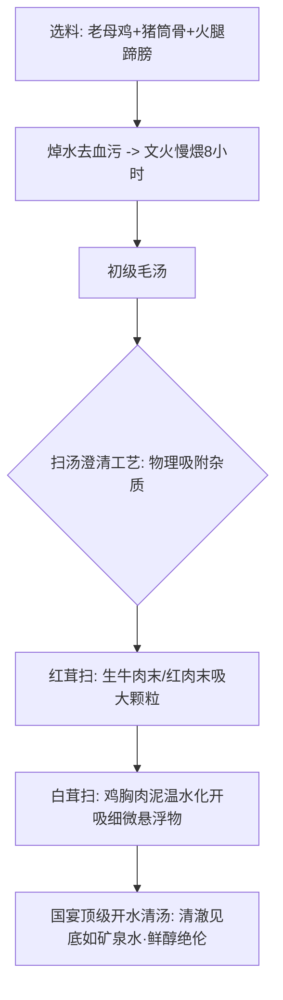

# 中华料理大厨烹调全书 (八大菜系传世大菜·镬气火候·高汤扫汤·复合味型库)

---

## 第一章 中厨基本功工法：刀工、浆糊芡与火候量化

### 1.1 刀工体系与热传导对应
- **顺纹与逆纹**：“横切牛羊、竖切猪肉、斜切鸡鱼”。牛肉肌纤维粗壮，必须逆着肌理横切（打破长肌纤维），否则熟后塞牙嚼不烂；鸡肉娇嫩，顺着纹理斜切能保持爆炒后不易碎散。
- **经典复合花刀**：
  - **麦穗花刀**（腰花、鱿鱼）：剞直刀至深度 4/5，再斜 45° 剞斜刀，遇热受力不均自然卷曲如金黄麦穗。
  - **菊花花刀**（菊花鱼）：直切交叉细丝，裹脆皮糊炸制，形如秋菊盛开。

### 1.2 上浆、挂糊与勾芡科学 (Starch & Gelatinization)
1. **蛋清淀粉浆 (滑炒专用)**：每 500g 肉丝/肉片加盐 4g、黄酒 10ml，抓出胶质后打入蛋清 1 个，顺时针搅打上劲，最后加入红薯淀粉 15g 与冷油 15ml 封油。下锅滑油肉质极度水灵脆弹。
2. **脆皮糊 (外酥里嫩之王)**：低筋面粉 60g + 玉米淀粉 40g + 泡打粉 3g + 清水 100ml + 色拉油 15ml（油水乳化起层，炸出如冰花般酥脆空壳）。
3. **勾芡三态**：
   - **包汁芡 (厚芡)**：淀粉量大，汤汁牢牢包裹在主料表面（如糖醋里脊、麻婆豆腐）。
   - **流汁芡 (中芡)**：具有流动性，盘底略带红亮油汁（如鱼香肉丝、宫保鸡丁）。
   - **米汤芡 (薄芡)**：似米汤般轻盈，增加汤汁粘稠度与保温性（如酸辣汤、白灼时蔬）。

---

## 第二章 中华国宴级吊汤全法与“红白茸扫汤”神技

汤是中餐的底蕴与灵魂。“唱戏的腔，厨师的汤”。

1. **初级毛汤熬制**：选用三年以上老母鸡 1 只、猪筒骨 2 根、金华火腿 150g、鸭架半副。沸水焯透洗净，加冷水 10 升、拍姜葱结，大火烧开转微火慢炖 6 小时，滤去骨渣。
2. **红茸与白茸澄清神技 (Clarification)**：
   - 将鸡胸肉 200g 用刀背细细砸成极其细腻的肉泥（鸡茸），加冷高汤化开成稀糊状。
   - 汤桶烧至将沸未沸（约 90℃，微起细泡），由中心旋涡式倒入鸡茸。
   - 鸡肉泥在受热凝固过程中，如同一张巨大的蛋白质滤网，将汤中所有悬浮的微小油脂和杂质彻底吸附聚拢成肉饼浮于水面。
   - 轻轻捞出鸡肉饼，剩余的高汤**清亮透明如纯净水，但香气扑鼻，鲜度醇厚入骨**（此即国宴名菜“开水白菜”之灵魂底汤！）。

---

## 第三章 八大菜系代表传世大菜极客出品 SOP

### 1. 【川菜】传统宫保鸡丁 (经典糊辣荔枝口)
- **风味精髓**：先闻糊辣之香，入口微甜微酸，咸鲜适度，尾带花椒微麻，鸡肉滑嫩，花生酥脆。
- **物料配比**：
  - 鸡大腿肉 250g（切 1.5cm 见方丁，蛋清淀粉浆腌制）
  - 七星椒节 15g、大红袍花椒 4g、去皮油炸花生米 60g、大葱白段 60g
  - **绝密黄金调料碗汁**：保宁醋 15ml + 白糖 18g（甜酸平衡核心）+ 生抽 12ml + 老抽 2ml + 黄酒 10ml + 盐 1g + 水淀粉 15ml + 高汤 20ml
- **出品 SOP**：
  1. 锅烧至冒青烟，下熟菜籽油滑锅后留底油，下花椒和辣椒节，**小火慢煸至辣椒呈紫红微焦（糊辣香瞬间爆发）**。
  2. 立即转大火倒入鸡丁，快速滑炒 15 秒至鸡丁粒粒散开变白。
  3. 下大葱白丁与姜蒜片，大火翻炒激发出葱香味。
  4. 顺锅边烹入预调好的黄金碗汁，锅内瞬间爆鸣，大火颠翻抛锅 5 秒使芡汁均匀紧裹鸡肉。
  5. 临出锅下入酥脆花生米，快速翻匀出盘。花生米必须最后下，保持绝对香脆！

### 2. 【粤菜】顺德古法脆皮白切鸡 (骨带微红·皮爽肉滑)
- **制作核心**：选用 1.2kg 清远走地三黄鸡。水温恒定在 **88℃~90℃ 虾眼水**，三提三浸平衡体温，微火慢浸 25 分钟（中心骨髓温控在 68℃ 熟化不断生）。
- **冰水激皮**：捞出立即投进 0℃ 冰水中急降温 15 分钟，皮下胶原蛋白瞬间凝固脆化。
- **蘸料配方**：新鲜沙姜碎 25g + 小葱白 20g + 食盐 3g，浇入烧至八成热的花生油爆出奇香。

### 3. 【鲁菜】经典葱烧海参 (大葱炼油·浓汁透骨)
- **核心技艺**：章丘大葱白剖半切段。慢火用熟猪油将葱白煎至金黄焦香，提炼出浓郁深金色的“头道葱油”。
- **烧制**：发制好的海参入高汤焯透去腥；锅留葱油，下冰糖炒至微黄，烹绍酒、酱油与浓高汤，下海参及煎透的焦葱白，微火慢煨 5 分钟让海参内部充分入味；大火收汁，淋入淀粉水抱紧浓汁，出锅前淋入一勺滚烫明亮头道葱油，乌黑发亮、葱香浓郁！

### 4. 【苏菜】松鼠鳜鱼 (乾隆赞誉·酸甜酥脆)
- **刀工**：活鳜鱼去骨，皮朝下，先直剞 0.5cm 细密条纹，再斜剞 45° 刀纹，形成深达鱼皮但不破皮的整齐菱形麦穗肉粒。
- **挂糊与炸制**：鱼身扑满干淀粉，抖净余粉。手提鱼尾，将热油浇在鱼肉上使花刀炸散定型如松鼠毛，投入七成热油锅中炸至金黄定型、坚硬酥脆捞出装盘。
- **糖醋红汁**：番茄酱 50g + 白糖 40g + 白醋 30g + 盐 2g + 清水 60g 烧开勾玻璃芡，淋入明油，滚烫浇淋在炸好的鱼身上，发出“滋滋”声响如松鼠欢鸣！

### 5. 【闽菜】百年非遗聚宝佛跳墙
- **食材汇聚**：水发鱼翅、刺参、九孔鲜鲍、花胶、瑶柱、金华火腿、蹄筋、老母鸡、香菇、鸽蛋共十八味珍品。
- **煨炖工法**：分别经煸、煨、炸各制其味；一同装入绍兴百年老酒陶坛中，注入以老母鸡、排骨、火腿慢熬而成的浓郁金黄顶汤，调入老酒；坛口以双层新鲜荷叶与牛皮纸紧紧扎封，加盖置于炭火上，微火慢煨 6 小时。揭盖瞬间，浓香飘逸，软糯荤香，润而不腻。

### 6. 【湘菜】镬气爆炒小炒黄牛肉 (8秒极速出锅)
- **选料与切配**：牛里脊顺切大条、横切 1.5mm 薄片。加入生抽、蚝油、湿淀粉抓匀，封食用油冷藏。
- **爆炒动线**：熟铁锅干烧至冒大烟，下油滑锅倒出，再下冷油。下大蒜瓣、姜丝、野山椒碎猛火爆香 3 秒，倒入黄牛肉猛火狂炒 5 秒变色断生，立即撒入新鲜芹菜段与红泡椒圈，烹入一圈生抽，颠锅 3 次，从下肉到装盘严格控制在 **10 秒以内**，镬气直冲咽喉！

---

## 第四章 经典复合味型精准克重调料兑汁库

中餐味型讲究“百菜百味”。以下为商用后厨标准预调比例（按 200g 主料菜品量计）：

| 味型名称 | 核心调料精准配比 | 典型代表菜品 |
| :--- | :--- | :--- |
| **经典鱼香味** | 保宁醋 15ml + 糖 12g + 泡红辣椒末 15g + 生抽 8ml + 姜蒜末各 8g + 葱花 + 水淀粉 10ml | 鱼香肉丝、鱼香茄子 |
| **正宗红油味** | 熟芝麻红油 30ml + 减盐生抽 15ml + 复制酱油 10ml + 蒜泥 10g + 熟白芝麻 3g + 白糖 4g + 汉源花椒面 1.5g | 口水鸡、红油抄手、夫妻肺片 |
| **地道怪味型** | 芝麻酱 15g (用红油澥开) + 酱油 10ml + 香醋 8ml + 白糖 10g + 花椒面 2g + 熟花生碎 15g + 熟芝麻 5g (咸甜麻辣酸鲜香并存) | 怪味鸡块、怪味蚕豆 |
| **醇香麻辣味** | 郫县红油豆瓣 25g + 刀口辣椒碎 15g + 茂县汉源花椒粉 3g + 豆豉 5g + 生抽 10ml + 蒜泥 10g + 鲜汤 150ml | 麻婆豆腐、麻辣水煮肉片 |
| **清鲜本味型** | 顶级清高汤 100ml + 盐 3g + 黄酒 5ml + 葱油 10ml + 白胡椒粉 0.5g + 极薄湿淀粉 | 糟溜三白、白灼虾、开水白菜 |
| **蒜香避风塘** | 炸金黄酥蒜蓉 50g + 炸面包糠 30g + 干豆豉碎 10g + 炸红椒碎 5g + 淮盐/椒盐 3g + 细糖 2g | 避风塘炒蟹、避风塘大虾 |
