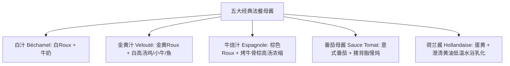

# 正统西餐与米其林级技法 (牛排熟度温控·五大母酱·经典意面)

---

## 一、 牛排终极科学：部位选型、美拉德反应与中心温度

家庭与专业西厨煎牛排的最大误区：凭感觉看时间。专业西厨依靠**厚度、红外锅温与探针中心温度（Core Temp）**：

### 1. 牛排四大经典部位与风味选型
- **肋眼 (Ribeye)**：油花极其丰富（有明显油脂眼），肉香与奶香浓郁，最适合煎至 **五分熟 (Medium)** 激发油花融化。
- **菲力 (Filet Mignon)**：牛腰部最嫩的一小块肌肉，脂肪极低无筋膜，肉质极其软嫩，适合 **三分熟 (Medium-Rare)**。
- **西冷 / 纽约客 (Striploin)**：外侧有一圈筋油边，肉质紧实有嚼劲，肉味浓郁，适合 **三分熟至五分熟**。
- **板腱 / 牡蛎肉 (Flat Iron)**：性价比极高，油花细腻，中间有一根嫩筋，煎至微焦后筋膜脆弹。

### 2. 熟度与探针中心温度 (Core Temperature) 精确对照表
（测量时将探针从牛排侧面水平插入几何中心最厚处）：

| 熟度等级 (Doneness) | 离火出锅中心温度 (℃) | 静置后终点温度 (℃) | 切面颜色与肉汁状态 |
| :--- | :--- | :--- | :--- |
| **一分熟 (Rare)** | 46℃ ~ 48℃ | 49℃ ~ 51℃ | 表面焦褐，中心 75% 鲜红湿润，微凉软滑。 |
| **三分熟 (Medium-Rare)** | 50℃ ~ 52℃ | 54℃ ~ 56℃ | **米其林主厨公认最佳**。中心 50% 温暖粉红，汁水最为丰沛。 |
| **五分熟 (Medium)** | 56℃ ~ 58℃ | 60℃ ~ 62℃ | 中心 25% 浅粉色，油脂充分融化与肉纤维交融。 |
| **七分熟 (Medium-Well)** | 63℃ ~ 65℃ | 66℃ ~ 68℃ | 仅中心残留极微弱浅粉，肉质紧实有阻力。 |
| **全熟 (Well-Done)** | 70℃ 以上 | 72℃ 以上 | 全体灰褐无粉色，肉汁流失较多。 |

### 3. 米其林星厨煎牛排标准 SOP (7 步法)
1. **彻底室温回温 (Tempering)**：牛排提前 30~45 分钟从冰箱取出回温至室温 18℃~20℃（避免冰冷核心导致外焦内冰）。
2. **表面吸干水分 (Drying)**：用厨房厚纸巾用力包裹吸干表面所有渗出水分（水气阻碍温度达到 140℃ 美拉德临界点）。
3. **大颗粒海盐与黑椒调味**：出锅前 1 分钟大面积撒研磨粗海盐与现磨黑胡椒碎。
4. **高温铸铁锅激焦**：铸铁锅大火干烧至微微冒青烟（锅温约 230℃~250℃），淋入高烟点油脂（澄清黄油、牛油或鳄梨油）。
5. **快速封边锁焦**：放入牛排，两面各强火高温煎 60~90 秒，竖起牛排煎封四周侧边脂肪（渲染金黄酥脆焦壳）。
6. **黄油淋油裹香 (Basting)**：转中火，投入 25g 优质发酵黄油、2 瓣拍扁大蒜、2 枝新鲜迷迭香/百里香；倾斜锅具，用勺子不断舀起冒泡的坚果香溶化黄油，反复浇淋牛排表面 45 秒。
7. **离火醒肉 (Resting 5~8分钟，绝对不可省！)**：
   - 将牛排放于温热网架上静置。
   - **物理原理**：高温时肉质外层肌纤维收缩将肉汁逼向中心；静置时温度梯级传导使外层松弛，汁水被均匀重新吸收分布回每一束肌纤维。若立刻下刀，肉汁将瞬间溢满盘子，肉质沦为干柴！

---

## 二、 经典法餐五大母酱 (The 5 French Mother Sauces)

西餐酱汁的灵魂在于**面粉糊 (Roux) 的熟度控制与油脂乳化**：

- **经典荷兰酱制作要诀 (班尼迪克蛋灵魂)**：
  1. 蛋黄 2 颗加入 10ml 白葡萄酒醋与柠檬汁，置于微沸水浴上方（水不沸腾，盆底不可接触水面，温度维持在 55℃~60℃）。
  2. 用蛋抽快速打发至体积膨胀 2 倍成浓稠鹅黄糊状。
  3. 缓慢、细流状滴入 100g 融化温热澄清黄油（Ghee），边滴边飞速抽打乳化。
  4. 调入卡宴辣椒粉与海盐，质地如丝绒般垂坠滑亮。

---

## 三、 正统罗马风味培根蛋黄意面 (Spaghetti alla Carbonara)

> ⚠️ **正统警告**：正宗意大利罗马 Carbonara **绝对不加淡奶油、不加牛奶、不加大蒜与洋葱**！浓郁顺滑的奶酪酱全靠**蛋黄与面汤的高温乳化**。

- **食材清单**：
  - 意面 (Spaghetti n.5)：100g
  - 传统意式风干猪脸颊肉 (Guanciale，平替可用厚切烟熏五花肉 Pancetta/Bacon)：60g
  - 鲜鸡蛋：1 颗全蛋 + 2 颗优质生食级蛋黄
  - 佩科里诺羊奶酪 (Pecorino Romano) 与 帕玛森奶酪 (Parmigiano)：研磨细碎各 20g
  - 现磨粗粒黑胡椒碎：大量的现磨黑胡椒（提供辛香解腻）
- **出品 SOP**：
  1. **煮面与留汤**：大锅沸水加 1% 盐，下意面煮至比包装标注时间少 2 分钟（保留芯内硬度 Al dente）。**盛出半碗富含淀粉的面汤备用**。
  2. **煸炒猪脸颊肉**：冷锅下切成 1cm 宽条的猪脸颊肉，小火慢煸 5 分钟，将油脂彻底煸出，肉质外焦脆内柔软，离火。
  3. **调制蛋黄奶酪膏 (Carbocream)**：碗中混合蛋黄、全蛋、奶酪碎与大量黑胡椒，用叉子搅拌成浓稠膏状。
  4. **极速温控乳化 (最关键一步，防止变成炒鸡蛋)**：
     - 将煮熟的意面直接捞入盛有煸脆肉块与油脂的煎锅中。
     - **锅具必须彻底离火，静置降温 15 秒（锅温低于 70℃）**。
     - 倒入蛋黄奶酪膏与 30ml 滚烫的意面淀粉汤。
     - 双手迅速颠锅抛翻、夹子疯狂打圈乳化 20 秒。油脂、淀粉水与蛋黄奶酪在 65℃ 临界点融为一体，形成如天鹅绒般包裹在每一根面条上的金黄浓稠光泽！
  5. 盛入热盘，表面再现磨一层黑胡椒，趁热大口享用！
