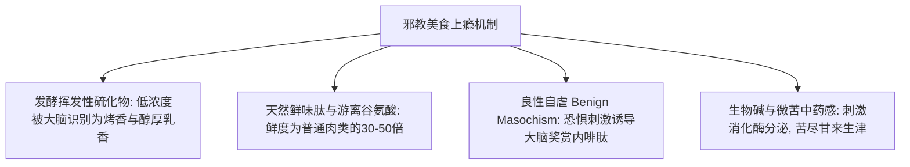

# 全国区域“邪教美食”全书 (十二大暗黑硬核料理·生化机理·非遗秘方·安全红线)

---

## 第一章 奇葩风味生化学：为什么“邪教美食”让人闻之作呕、食之上瘾？

在外人眼里是“不可思议的生化黑暗料理”，在本地老饕心中却是“千金不换的续命神仙美味”。生化学家研究发现，“邪教美食”的狂热成瘾性遵循着极为严苛的风味化学规律：

1. **硫醚化合物的双面性**：酸笋、臭豆腐、豆汁发酵产生的**二甲基二硫醚（DMDS）、对伞花烃与吲哚**，在稀释到特定阈值时，会精准激活人类嗅觉受体 OR51M1，与烤坚果、陈年干酪的香气回路高度重合。
2. **游离谷氨酸与肌苷酸（Umami 鲜味大爆炸）**：牛瘪、活珠子、生腌海鲜在分解过程中产生高浓度的**单磷酸肌苷（IMP）与游离游离氨基酸**，两者的协同效应（Synergism）让鲜味呈几何级数成倍放大。

---

## 第二章 全国十二大殿堂级“邪教料理”深度配方与安全规程

---

### 1. 【广西柳州】老坛酸笋石螺原汤螺蛳粉 (非预包装生化传奇)
- **风味灵魂**：酸辣鲜爽烫，老坛酸笋酸臭逼人，石螺汤底清甜微辛。
- **商用高汤与螺蛳爆炒配方 (以 20 碗粉计)**：
  - 田螺 / 石螺 1200g（浸泡吐沙 2 天，剪去螺尾尖）
  - 猪筒骨 1500g + 老母鸡骨架 1 副（焯水彻底洗净血污）
  - **香料配比**：八角 4个、山奈 8g、砂仁 6g、草果 1个拍破、鲜紫苏叶 30g（**螺蛳去腥提香灵魂**）、香叶 5片、桂皮 6g、干朝天椒 60g
- **出品 SOP**：
  1. **炒螺爆香**：热锅下菜籽油与熟猪油（1:1），下大蒜瓣、姜片、紫苏与香料爆香，倾入石螺猛火狂炒 5 分钟，淋入高度白酒激发出酒香逼走土腥，炒至螺口厣片自然脱落。
  2. **慢火吊汤 5 小时**：将炒透的石螺与骨架投入深汤桶，注入直饮冷水 15 升，大火烧开撇净浮沫，转**微火慢熬 5 小时**让螺肉鲜味融于骨胶原中。加入生抽、老抽、特级蚝油与冰糖调和咸甜。
  3. **老坛酸笋干煸去涩**：柳州深坛厌氧发酵 25 天的大头甜笋切丝，**锅内不放一滴油，小火干煸 3 分钟炒干多余水汽**，激发出极其纯粹的酸脆香臭风味。
  4. **合碗装配**：柳州陈米米粉煮软捞入碗底，浇入两勺滚烫原汤、两勺特制紫苏红油，盖上炸至金黄膨胀的炸腐竹、酥花生米、酸笋丝、酸豆角黑木耳丁与新鲜空心菜尖。

---

### 2. 【贵州黔东南】百草牛瘪火锅 (苗侗至高迎宾礼)
- **草本生化密码**：牛为反刍动物，进食天然百草（车前草、蒲公英、野藿香等），在前胃与十二指肠经消化液和微生物深度发酵，富含大量消化酶与植物叶绿素精华，具有极强的健胃利湿、消食解热功效。
- **制作 SOP 与灭菌标准**：
  1. 取健康高山黄牛小肠与胃结肠交界处未完全消化之草本青汁，用密目绢布反复挤压过滤 3 次，滤出青绿色的纯净草本汁液。
  2. **加香去腥煮沸灭菌**：原汁倒入大铁锅，加入新鲜刺芫荽（野香菜）、香柳、鲜南姜末与适量牛胆汁（调控苦味平衡点），**必须大火剧烈煮沸翻滚 15 分钟以上彻底灭菌**，撇去表面浮沫。
  3. **猛火爆炒干锅**：热锅下菜籽油，爆香大量小米辣、蒜米、花椒粒，倒入切薄片的黄牛前腿肉、牛百叶、牛黄喉大火爆炒至断生，倒入熬好煮沸的百草牛瘪原汤。
  4. **品尝体验**：初入口带有一股青草发酵的微苦与草腥，几秒后舌面迅速化开，转化为疯狂的生津回甘与清凉薄荷感！

---

### 3. 【云南德宏】傣族手撕牛撒撇 (生撒与苦撒)
- **精髓构架**：由“肉馅、蘸水、主食”三部分构成。
- **蘸水核心配方**：
  - 熬制并过滤澄清的牛苦肠原汁（煮熟放凉）150ml。
  - 加入极细的刺芫荽碎 15g、香柳碎 10g、鲜小米辣碎 10g、捣烂的大蒜泥 10g、烤熟白芝麻 5g、野柠檬汁 5ml、精盐 3g、极少量味精。
- **食用方式**：将炭火烤熟切薄片的黄牛肉干巴片、新鲜细米线、牛肚丝，浸入冰凉苦辛的撒撇蘸水中饱蘸一口吸入，酸辣苦鲜冷热交织，瞬间驱散亚热带酷暑！

---

### 4. 【川滇黔】野生折耳根（鱼腥草）拌万物与糊辣烧椒蘸水
- **生化脱腥转化**：折耳根令人畏惧的“鱼腥/死鱼草味”源于**癸酰乙醛**。
- **大厨去腥增脆秘法**：
  1. 摘去老须，保留脆白嫩根，切 3cm 小段。
  2. 加入 2% 食盐抓揉 2 分钟，静置 8 分钟，**倒掉杀出的深黄苦水（倒掉 70% 游离鱼腥草素）**。
  3. 调入：四川保宁醋 15ml + 减盐生抽 10ml + 捣碎蒜泥 10g + 柴火糊辣椒面 8g + 花椒油 3ml + 熟白芝麻 + 白糖 3g（以糖提鲜并中和酸辣冲劲）。
  4. 拌入刚出锅的热气腾腾狼牙土豆或夹在烤五花肉中，脆嫩爽口，越嚼越香甜！

---

### 5. 【广东潮汕】“潮汕毒药”——红膏生腌青蟹与生腌皮皮虾
- **食品安全红线 (核心铁律)**：
  - ⚠️ **绝对禁止生腌任何淡水水产（草鱼、河虾、田螺等！寄生虫感染风险极高）**！
  - ⚠️ 必须选用咸水深海活蟹，进店后**必须在 -20℃ 以下超低温冷库冷冻 24 小时以上彻底灭杀寄生虫囊蚴**后方可解冻腌制！
- **商业级独家生腌神仙汁配方**：
  - 减盐特级生抽 250ml + 潮汕正宗鱼露 50ml + 53度纯粮白酒 50ml（强效抑菌去腥）+ 绍兴加饭酒 50ml + 纯净水 120ml + 冰糖粉 40g 搅拌融化。
  - 辅料：大量拍碎大蒜末 60g、鲜红朝天椒圈 40g、红葱头碎 30g、带根香菜碎 50g、无籽鲜柠檬片 4 片。
- **腌制 SOP**：将洗净刷净的红膏蟹斩块入盒，倒入料汁完全没过蟹肉，盖密封盖，放入 **0℃~3℃ 恒温冷藏浸渍 4~6 小时**（皮皮虾腌 3 小时，生蚝腌 2 小时）。蟹膏凝固成果冻冰淇淋流心，蟹肉吸吮即化，咸鲜甘美如痴如醉！

---

### 6. 【老北京】传统纯正绿豆酸浆豆汁配焦圈咸菜
- **发酵生物学**：制造绿豆粉丝与淀粉的副产物，利用野生乳酸菌在 28℃~32℃ 下深度发酵产生乳酸、乙酸与微量硫化物，呈灰绿色微稠浆液。
- **煮制绝活 (微滚起泡不沸腾)**：
  - 大火煮沸会导致豆汁发生蛋白质聚沉，水渣分离变成清汤豆腐渣。
  - 必须用铜锅小火慢温，**当锅边微微翻起细微气泡（约 88℃~92℃）时立即改极微火保温**。
  - 搭配炸得酥脆的焦圈与切成极细发丝的红油辣油水疙瘩芥菜丝，大口趁热吸溜，初闻如酸馊泔水，咽下后满口回甘泛起温润豆香！

---

### 7. 【南京 / 苏皖】原汁活珠子 (生命胚胎的极致鲜味)
- **标准定义**：受精孵化到 **第 11~12 天的鸡胚**（胎盘血管清晰，骨骼未钙化，无硬毛与嘴爪感，与 18 天以上羽毛骨骼完全长成的毛鸡蛋有云泥之别）。
- **温控水煮 SOP**：
  - 必须**冷水下锅**，加少许食盐。
  - 大火烧至微沸，立即改**微火慢煨 15 分钟**（防蛋壳内外温差炸裂漏汁）。
- **食用仪式**：轻轻敲破大头气室，剥开一小块蛋壳，先**凑嘴深吸一口温热鲜美至极的胚胎黄金囊液**，再蘸少许炒熟五香椒盐大口吞咽，嫩如脑髓！

---

### 8. 【湖南长沙】火宫殿古法黑老卤臭豆腐
- **黑色老卤发酵配方**：冬笋 10kg、鲜香菇 5kg、浏阳豆豉 5kg、纯碱、食盐在瓦缸中厌氧发酵 6 个月提取黑稠发酵母液。
- **炸制与灌汤**：
  - 嫩豆腐坯在黑卤水中浸泡 2~4 小时至通体墨黑内部洁白。
  - 入七成热茶籽油锅猛火炸至表皮迅速膨化起坚硬酥脆外壳。
  - 筷子在豆腐中心戳破一个洞，迅速灌入一勺鲜高汤、蒜泥水、辣椒油与榨菜香菜碎，外焦里嫩，咬开瞬间滚烫鲜汁直爆口腔！

---

### 9. 【浙江宁波 / 绍兴】“江南三臭”——臭苋菜梗与臭冬瓜
- **发酵之王**：夏末粗壮苋菜梗切 5cm 段，浸泡清水至起白沫，捞出沥干拌海盐入陶坛封死发酵 15 天，内部肉质完全化为翠绿清凉的果冻流质。
- **食用方式**：将发酵透的臭苋菜梗浇上一勺生熟花生油与干辣椒蒸透。端上桌臭气熏天，用嘴轻轻一吮，清咸冰凉的嫩芯如天然咸味冰沙般滑入喉头，是江浙老饕的极致下饭压桌神物！

---

### 10. 【福建闽南】野生海土笋冻 (天然海洋胶原蛋白)
- **本质解析**：可口革囊星虫（沙虫的一种），体内富含极高密度的水溶性动物明胶蛋白。
- **凝固制作法**：将泥沙彻底挤压漂洗干净的星虫倒入大铁锅，加入适量清水与少许食盐，大火滚煮至虫体胶原蛋白彻底水解融入沸汤中。盛入小瓷碗中自然冷却至室温，放入冰箱冷藏凝结成晶莹剔透的水晶冻。佐以蒜蓉、陈醋、芥末与酱油，冰凉脆嫩爽滑弹牙！

---

### 11. 【贵州凯里】苗家红酸汤江团鱼
- **灵魂酸汤**：野生毛辣果（野生小西红柿）、鲜红朝天椒、生姜、糯米甜酒入陶坛自然发酵 30 天而成的浓郁红酸汤。
- **点睛之笔**：出锅前必须滴入两滴纯正**野生木姜子油 (Litsea Cubeba Oil)**，其特殊的柠檬醛风味瞬间升华汤底，酸烈开胃，鱼肉嫩如豆腐！

---

### 12. 【新疆南疆】炭火现烤羊大腰与爆浆羊眼
- **去骚处理技法**：新鲜羊腰横剖剖开，彻底剔除内部白色输尿管筋膜（骚味唯一源头）。保留外部包裹的厚厚一层羊网油。
- **炭烤 SOP**：红柳木无烟炭大火强烤，羊油被烈火烤得滋滋冒泡滴落，油香将内部腰子爆熟，撒上安集海辣椒面与托克逊孜然粒。外层焦脆如油渣，内里如鹅肝般滑嫩无任何异味！
