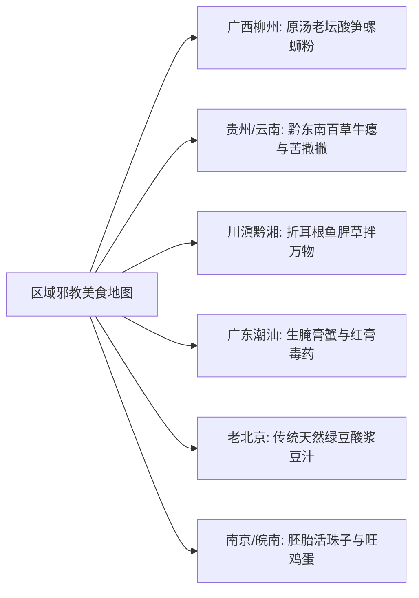

# 区域“邪教美食”全书 (螺蛳粉·牛瘪撒撇·折耳根·生腌·豆汁·活珠子)

---

## 一、 风味科学：为什么“邪教美食”让人极端两极分化且极致上瘾？

所谓“区域邪教美食”，往往在外地人眼中是“生化武器”，而在当地食客舌尖上却是“人间至味”。从风味化学与神经生物学角度看，它们共同遵循着三大上瘾机制：
1. **厌氧发酵与挥发性有机硫化物**：如螺蛳粉酸笋、臭豆腐卤水中的对伞花烃、二甲基二硫醚等，浓度微弱时大脑会将其解码为“浓缩坚果、烘烤与动物蛋白鲜甜”，浓度过高则闻起来臭。
2. **游离谷氨酸与肌苷酸核苷酸（Umami 爆炸）**：牛瘪、生腌海鲜、活珠子胚胎中含有天然浓度的鲜味肽，鲜度是味精的数十倍，直接刺激舌尖 T1R1+T1R3 鲜味受体。
3. **“良性自虐 (Benign Masochism)”与内啡肽奖励**：折耳根的辛烈、撒撇的微苦中药感、豆汁的酸浆刺激，先给大脑制造虚假的“危险毒物预警”，当机体发现无害后，大脑会奖赏性疯狂分泌内啡肽与多巴胺，产生欲罢不能的颅内高潮。

---

## 二、 六大殿堂级“区域邪教料理”深度配方与安全规程

---

### 1. 【广西柳州】地道老坛石螺原汤螺蛳粉 (非预包装泡面版)
- **风味灵魂**：臭、辣、鲜、酸、烫。螺汤清甜带微辛，酸笋脆嫩酸臭扑鼻。
- **核心汤底配方 (以 20 碗粉汤量计)**：
  - 田螺 / 石螺：1000g（浸泡吐沙 2 天，剪去螺尾）
  - 猪筒骨 1000g + 散养土鸡骨架 1 个（焯水洗净）
  - 香料包：八角 3个、山奈 8g、砂仁 5g、草果 1个拍破、紫苏叶 15g（螺蛳绝配灵魂）、香叶 4片、干辣椒 50g
- **出品 SOP**：
  1. **炒螺激香**：热锅下熟菜籽油与猪油（1:1），爆香大量姜片、蒜瓣、紫苏与香料，倒入沥干的石螺大火猛炒 5 分钟，淋入高度米酒逼去泥腥，炒至螺口盖子脱落。
  2. **吊高汤**：将炒香的石螺与骨架投入大汤桶，注入纯净水 12 升，大火烧开撇去浮沫，转**文火慢熬 4~5 小时**，螺肉香气与骨髓胶质彻底融出。调入生抽、特级蚝油、冰糖与盐。
  3. **炼制柳州红油**：纯菜籽油烧至 7 成热，分三次浇在粗细混合的朝天椒粉、白芝麻与紫苏碎上，静置浸出红亮香辣油。
  4. **老坛酸笋预处理**：选用柳州大头甜笋厌氧密封自然发酵 20 天以上的酸笋，切丝。**必须无油干锅慢火煸炒 3 分钟**（炒出水汽，激发刺鼻酸爽风味，口感极其脆嫩）。
  5. **出锅组合**：柳州陈米米粉煮软沥干入碗，浇入滚烫螺蛳原汤与两勺红油，码上炸腐竹、炸花生米、酸笋丝、酸豆角黑木耳丁与空心菜嫩尖。

---

### 2. 【贵州黔东南 / 云南德宏】百草牛瘪火锅与牛撒撇 (高阶药膳)
- **文化渊源**：苗侗与傣族待客最高礼遇。牛羊食百草，其胃肠液被视为吸纳了高山天然草药精华的“百草琼浆”，具有健胃清热功效。
- **安全警告与卫生红线**：
  - ⚠️ 必须选用当天宰杀、吃天然高山牧草的健康黄牛，取前胃（瘤胃）与未完全消化的近小肠液。
  - ⚠️ **取出的原液必须彻底加高温煮沸并双层纱布精细过滤**，严禁生食或温度不足。
- **制作步骤**：
  1. **取汁与过滤**：取出牛胃中未消化之嫩草浆，挤出草本消化原液，使用细目绢布彻底过滤掉残渣，获得翠绿微稠汁液。
  2. **加香去杂慢熬**：锅中不放油，倒入原汁，下新鲜刺芫荽（野香菜）、香柳、南姜泥、少许牛胆汁（调控苦度），大火烧沸煮透 15 分钟，撇去所有浮沫。
  3. **爆炒主料**：另起铁锅下菜籽油，爆香小米辣碎、蒜末、花椒，下切成薄片的牛里脊肉、牛百叶、牛黄喉大火爆炒至断生。
  4. **合汤开锅**：将熬好的百草牛瘪原汤冲入炒好的肉锅中，开小火慢煮。入口微苦带草木香，随后舌底疯狂生津回甘，浑身通透微汗！

---

### 3. 【川滇黔】折耳根（鱼腥草）拌万物与烧椒蘸水
- **生化解析**：折耳根的“鱼腥/肥皂味”主要来自**癸酰乙醛（鱼腥草素）**。通过物理揉搓破坏细胞壁，加入醋酸与大蒜素，可迅速将其降解转化为清新的草木辛甘香。
- **经典凉拌折耳根配方**：
  - 新鲜野生折耳根（取白嫩嫩嫩根）200g，掐成 3cm 小段。
  - **杀水脆化**：加入 3g 食盐抓匀腌制 8 分钟，倒掉杀出的苦涩黄水（去除 60% 刺激腥味，只留脆爽）。
  - **拌料灵魂**：生抽 15ml + 四川保宁醋 15ml + 现捣蒜泥 10g + 糊辣椒面（柴火慢烘舂碎）8g + 花椒油 3ml + 熟白芝麻 + 白糖 3g（提鲜解冲）+ 葱花。
  - 翻拌均匀静置 5 分钟，配上一碗白米饭或裹在烤五花肉里，是西南人民的救命神菜！

---

### 4. 【潮汕】“潮汕毒药”——红膏生腌蟹与皮皮虾
- **为什么叫“毒药”**：指鲜美到极致，吃过一次就如上瘾般朝思暮想。
- **食品安全红线 (核心生命线！)**：
  - ⚠️ **严禁生腌任何淡水水产**（草鱼、河虾、福寿螺绝对不可！寄生虫感染率极高）。
  - ⚠️ **必须选深海咸水活鲜**，且食用前建议在 **-20℃ 以下商业冷冻 24 小时以上**进行深度物理杀虫灭囊。
- **独家生腌料汁配方**：
  - 减盐特级生抽 200ml + 潮汕纯正鱼露 40ml + 53度纯粮高度酱香白酒/特制雕王黄酒 60ml（抑菌消毒与去腥回甜）+ 纯净水 100ml + 白砂糖 30g。
  - 配料：大蒜头 2 整头切碎末、红葱头碎 30g、鲜红朝天椒圈 30g、香菜连根碎 50g、鲜柠檬片 3 片（去籽）。
- **腌制 SOP**：
  1. 活红膏青蟹刷洗干净，揭盖去鳃与脐部，斩成四块。
  2. 将蟹块浸入密封保鲜盒，倒入调好的生腌料汁，料汁必须完全没过蟹肉。
  3. 盖紧盒盖，放入 **0℃~2℃ 冰箱冷藏浸泡 4~6 小时**（皮皮虾腌 3 小时，生蚝腌 2 小时）。
  4. 捞出装盘，蟹膏如冰淇淋般凝固流心，蟹肉果冻般吸吮即化，咸鲜甘甜直冲天灵盖！

---

### 5. 【老北京】传统纯正绿豆酸浆豆汁配焦圈
- **工艺源流**：绿豆浸泡磨浆沉淀出绿豆淀粉后，剩余的酸性浆液经野生乳酸菌在恒温下自然发酵。
- **煮制绝活 (滚起不滚沸)**：
  - 豆汁不能用大火死煮，大火滚沸会导致蛋白质聚沉水析，变成一锅清汤渣滓。
  - 锅底微热倒入生豆汁，**小火慢养至锅边微微泛起细小气泡（约 90℃，即将沸腾状态）立即关小火**。
  - 配上一碟切得极细极脆的红油水疙瘩咸菜丝，趁热一手拿炸得金黄酥脆的焦圈，吸溜一大口微酸微馊的热豆汁，细品带有悠长的绿豆醇厚清香。

---

### 6. 【南京 / 皖南】原汁活珠子 (生命最初的鲜味)
- **食材标准**：受精孵化到 **第 11~12 天的鸡胚蛋**（此时鸡胚已成型，胎盘血管丰盈，肉质最嫩，无坚硬骨骼与羽毛感，与全毛毛蛋有本质区别）。
- **温控煮制法**：
  - 必须**冷水下锅**，加一小勺食盐与两片生姜。
  - 大火煮至水温上升到微沸，立刻转**微小火慢煨 12~15 分钟**（火大壳内气室膨胀会导致蛋壳爆裂鲜汁流失）。
- **品尝仪式 (吸髓知味)**：
  1. 轻轻敲破大头一侧的气室蛋壳，剥开一小块硬壳与内膜。
  2. 凑上嘴唇，先**深吸一口温热鲜美的胚胎囊液（极鲜微甘的“黄金汤”）**。
  3. 撒少许炒焦的椒盐，将滑嫩的胚肉与蛋黄一并滑入口中，极度浓郁鲜嫩！
