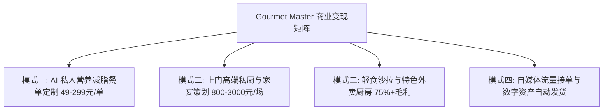

# 美食内容创业、AI 私厨顾问与商业变现全攻略工具箱

---

## 第一章 四大高毛利美食变现业务模型拆解

美食赛道拥有全网最大的消费基数与最高的复购粘性。本工具箱将知识、配方与算法转化为真金白银的变现业务：



---

## 第二章 模式一：WorkBuddy “AI 个人营养减脂顾问”极速交付模版

利用 WorkBuddy 挂载本技能后，只需输入客户基础身体数据，即可一键生成价值 **¥199** 的专业级私人减脂定制全案：

### 2.1 客户问卷诊断模板
- 年龄/性别/身高/当前体重/目标体重
- 每日作息与运动习惯（久坐/跑步/力量训练）
- 饮食偏好与过敏史（是否能吃海鲜/香菜/是否乳糖不耐）
- 烹饪条件（自炊/外卖/空气炸锅/微波炉）

### 2.2 WorkBuddy 自动化生成的高价值交付结构示范
```markdown
# 📋 [客户姓名] 专属 28 天精准减脂与高蛋白备餐方案
> **基础评估**：当前 BMR 1350 kcal | 每日 TDEE 1850 kcal | 设定摄入目标 1450 kcal (安全缺口 400 kcal)  
> **宏量指标**：蛋白质 110g (30%) | 碳水化合物 145g (40%) | 优质脂肪 45g (30%)

### 一、 一周高蛋白备餐 (Meal Prep) 采购清单 (直连京东到家/朴朴)
- **优质蛋白**：去皮鸡胸肉 1.2kg、冷冻大虾仁 500g、牛腱肉 800g、鸡蛋 2 盒
- **优质慢碳**：贝贝南瓜 2 颗、纯荞麦面条 1 包、即食燕麦片 500g
- **高纤蔬菜**：西兰花 2 颗、小番茄 2 盒、紫甘蓝半颗、无土生菜 2 棵

### 二、 周一至周五毫克级食谱与卡路里核算表
| 星期 | 早餐 (约 350 kcal) | 午餐 (约 550 kcal) | 晚餐 (约 450 kcal) | 加餐 (100 kcal) |
| :--- | :--- | :--- | :--- | :--- |
| **周一 (中碳)** | 隔夜奇亚籽酸奶碗+水煮蛋 | 柠檬黑椒爆汁鸡胸180g+蒸南瓜150g+水焯西兰花 | 滑蛋牛肉全麦卷饼+紫洋葱彩椒 | 黑咖啡+蓝莓50g |
...
```

---

## 第三章 模式二：高端上门私厨与宴席设计业务 SOP (单场 ¥800~¥3000)

年轻家庭生日宴、商务宴请、朋友聚会越来越倾向于“请大厨上门做饭”。

### 3.1 8~10人高端家宴菜单设计范例 (人均成本 ¥60，收费 ¥1500 服务费)
- **冷盘前菜**：潮汕红膏生腌青蟹（按 `04_cult_regional_food.md` 深度灭菌）、捞汁折耳根牛肉、五香酱牛肉、桂花蜜藕。
- **热炒硬菜**：
  - 【主菜一】米其林经典法式惠灵顿牛排（现场分切展示粉红三分熟，仪式感拉满）
  - 【主菜二】顺德古法脆皮白切鸡（佐沙姜花生葱油）
  - 【主菜三】古法秘制本帮红烧肉（砂锅慢炖不加一滴水，红亮粘唇）
  - 【主菜四】避风塘蒜酥九孔鲍鱼
  - 【素菜】国宴级开水白菜（采用白茸扫汤高汤，清澈如水惊艳全场）
- **汤品甜点**：养生花胶土鸡浓汤 + 意大利正统带酒香马斯卡彭提拉米苏。

### 3.2 私厨上门服务流程标准化
1. **D-1 备料与半成品准备**：提前将牛肉焯水切分、鸡胸肉水合浸泡、高汤吊好过滤、酱汁调配入分装瓶。
2. **D-Day 现场操作**：提前 2 小时到客户家中，检查燃气灶与烤箱；严格遵循中西餐出菜顺序；出完最后一道菜后，将客户厨房**打扫清洁至一尘不染，垃圾袋装带走**（极致口碑，转介绍率高达 80%！）。

---

## 第四章 模式三：轻食外卖店与特色餐饮档口 0-1 启动模型

### 4.1 减脂轻食碗单份 BOM 成本与 75% 毛利定价拆解
| 组成部分 | 原料消耗与克重 | 单份进价成本 (¥) |
| :--- | :--- | :--- |
| **核心肉类蛋白** | 3%盐糖浸泡鸡胸肉 160g / 减盐卤牛腱肉 80g | ¥ 2.10 ~ ¥ 3.20 |
| **主食慢碳** | 蒸贝贝南瓜 80g + 三色糙米饭 80g | ¥ 0.70 |
| **丰富配菜蔬菜** | 水焯西兰花 60g + 玉米粒 30g + 圣女果 3颗 + 生菜底 | ¥ 1.10 |
| **自制灵魂酱汁** | 自制泰式酸辣汁 / 油醋汁 35ml (参考 01 章节自制) | ¥ 0.45 |
| **高档牛皮纸包装** | 加厚牛皮纸沙拉碗 + 高透防雾盖 + 独立木质餐具套 + 贴纸 | ¥ 0.85 |
| **单份综合硬成本** | **总成本：¥ 5.20 ~ ¥ 6.30** |  |

> **售价与收益**：线下自提/堂食售价 **¥ 22.00**（毛利率 **73%**）；外卖平台标价 **¥ 29.90**，设置满减（满 28 减 8），实收 ¥ 21.90，扣除平台 20% 扣点后净收 ¥ 17.52，每单稳赚纯利 **¥ 11.50**！每日 80 单即可月入净利近 3 万元！

---

## 第五章 模式四：自媒体百万爆款流量脚本库 (小红书/抖音/视频号)

### 5.1 爆款选题策略：反常识认知与极致猎奇
- **选题 1 (认知颠覆)**：*“别再傻傻水煮鸡胸肉了！大厨教你 3% 盐糖浸润法，嫩过豆腐还爆汁！”*
- **选题 2 (猎奇挑战)**：*“吃完喉咙冒烟？挑战贵州百草牛瘪火锅与生腌毒药，第一口我就跪了！”*
- **选题 3 (降维打击)**：*“西餐厅卖 288 的惠灵顿牛排，成本其实只要 38？完整防塌皮秘方公开！”*

### 5.2 60秒短视频黄金脚本 (以《减脂爆汁鸡胸肉》为例)
- **【0~3秒 痛点反转】**：镜头特写一块干瘪发白的水煮鸡胸肉被扔进垃圾桶，画外音：“*吃水煮菜减脂的，你是在自我感动！难怪你坚持三天就暴饮暴食！*”
- **【4~12秒 视觉冲击】**：镜头切换，一刀切开刚出锅的香煎鸡胸肉，肉汁如泉水般疯狂涌出，镜头极近特写汁水反光，画外音：“*看这块肉，比豆腐还嫩，咬下去全是肉汁！热量只有 380 大卡，蛋白质高达 42 克！*”
- **【13~40秒 硬核生化教学】**：快速快节奏分镜：“*记住这个核心比例：1000ml 水加 30g 盐、15g 0卡糖。生化原理是利用渗透压改变蛋白质电荷，锁死 18% 水分……*”
- **【41~52秒 煎制与调味】**：大火煎 90 秒锁色，关小火加盖焖 2 分钟，出锅淋柠檬汁与黑胡椒。
- **【53~60秒 CTA 转化】**：“*点赞收藏，你的 28 天无痛掉秤减脂餐单已经在评论区整理好了，赶紧去领！*”
